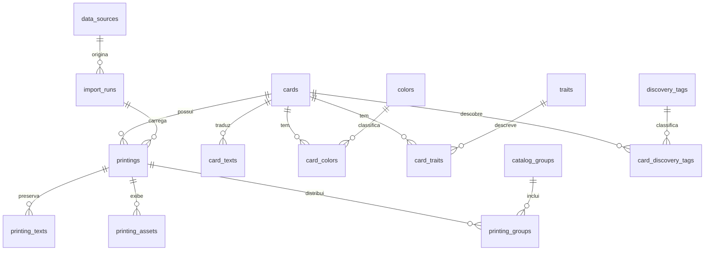
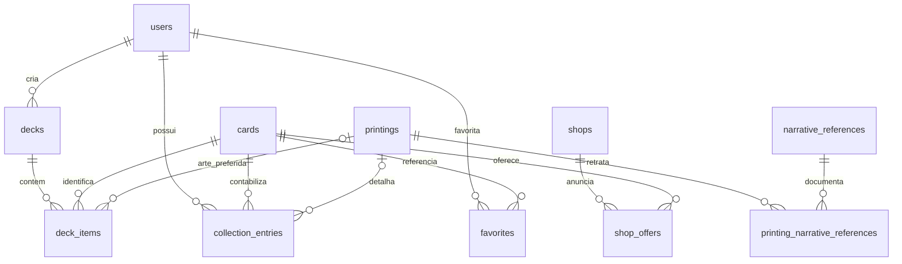

# Relacionamentos principais

O modelo separa identidade, arte, características do jogo e classificação editorial. As relações de catálogo são protegidas contra exclusões acidentais: registros usados devem ser arquivados. Exclusão em cascata fica restrita a dependências pessoais/itens de um deck quando a remoção física for deliberada.

O diagrama completo, com todas as FKs, está em `mer-completo.mmd`. As colunas exatas estão em `DICIONARIO.md`. Algumas relações opcionais de arte são FKs compostas `(printing_id, card_id)`, garantindo que a arte pertença à identidade escolhida.

## Exemplo concreto

- `cards.card_id = OP01-025`: identidade de Roronoa Zoro, usada no limite de cópias.
- `printings.legacy_uid = OP01-025` e outros UIDs do mesmo ID: diferentes registros de impressão, cada um com sua imagem, raridade e distribuição.
- `card_colors`: uma ou mais cores em linhas próprias; sem listas de cores em uma coluna de texto.
- `printing_groups`: uma ou mais origens de distribuição por arte; sem forçar todos os registros a um produto físico único.
- `card_discovery_tags`: filtro Herói/Pirata/D. conforme regra editorial identificada, separado de `traits`.
- `printing_narrative_references`: a relação com capítulo/capa/episódio pertence à arte, não automaticamente a toda carta com o mesmo ID.
